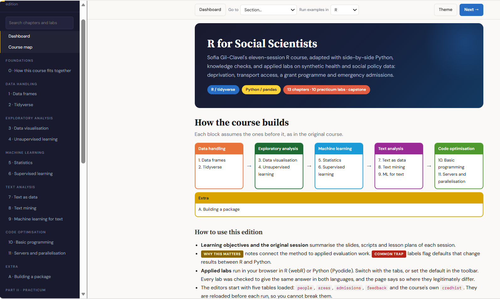

# Python for Tidyverse Users

You already know the tidyverse. This course takes what you know and shows you how to do the same things in Python, side by side, so you're not starting from scratch.

**[Open the course](https://meronmkifle.github.io/Python-for-Tidyverse-Users/)**

## What you get

- **20 chapters** with R and Python code next to each other, from setup and pandas through ETL, SQL, APIs, plotting, stats and machine learning.
- **22 hands-on labs** you can edit and run right in your browser. They work through realistic healthcare data tasks using synthetic records modelled on UK Biobank, HES and CPRD (no real patient data).
- **Quizzes** with instant feedback, a cohort simulator, a searchable R-to-Python cheat sheet and a dashboard that tracks your progress.

It's all in one `index.html` file. You'll need internet the first time you run code, because Python loads in the browser.

## Who it's for

Anyone comfortable with `dplyr`, `tidyr` and `ggplot2` who wants to get productive in Python quickly. Along the way it points out the differences that quietly cause bugs, like 0-based indexing, how pandas handles missing values, and join cardinality.

## ☕ Support

If you find this guide helpful, consider buying me a coffee!

